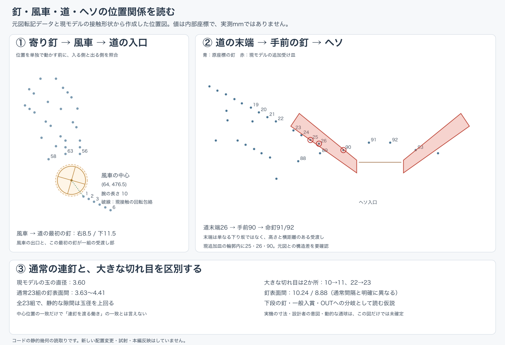

# 盤面図の読み直し：釘を「位置」から「受け渡しの関係」へ

2026-10-16。ユーザーの再掲図を見直し、デザインと実装の担当で独立に配置関係と距離を読み取り、PMが照合しました。元画像は904×1280、今回の参照添付E10B887A…/1-写真1.jpgです。原図は検証参照として扱い、製品素材へ転載していません。以下の「意図」は配置から読む機能仮説で、設計者の説明を得たものではありません。

今回、新配置の試射は0発、風車・釘・玉・物理・既存皿の製品変更は0です。前に用意した風車4方向の案は、今回の構造理解を優先して保留します。

## この盤面をどう読むか

|場所|配置から読む働きと理由|調整で一緒に見る関係|
|---|---|---|
|左上の入口と長い通路|狙った場所へ出た球を下の釘群へ届ける。上の釘列と下の釘群の間の長い空間も流路の一部|レール出口の幅・最初の接触・落下先。空白へ釘を追加せず、狙いを固定する|
|斜め・縦にずれた寄り釘|次に当たる釘、内側へ進む隙間、外側へ抜ける隙間を段階的に分ける配置と読める|1本だけでなく向かい側/斜め下の釘と装飾壁。中心距離に加え球が通る表面の隙間を見る|
|風車とその上下|上の釘群が風車のどこへ球を届け、風車のどの接触/回転位相から右下の道へ渡すかが一組|風車上の釘・実際の羽根外形・道の最初の釘の横距離/高さ。単純に近づければよいとはしない|
|右下がりの道釘と2つの切れ目|小さい間隔で次の釘へ渡る機会を作り、大きい切れ目では下段へ分かれる配置と読める|通常間隔と切れ目を区別。落ちた先にも釘/一般入賞があるため、道を外れた球を即OUT扱いしない|
|下段の釘と一般入賞|ヘソへ向かう流れから外れた球にも一般入賞の機会を持つ分配構造|ヘソ数に加えて一般入賞とOUT。全てをヘソへ向ける一様な坂へ置き換えない|
|道末端・手前の釘・命釘|末端から離れた釘を経て、少し高いヘソ両側の釘へ渡る。最後の横距離と高さが意味を持つ|勢い・入射角・反発とヘソ口への下降。開きだけでなく、最後まで届く球がどれだけあるか|

[先に提示された記事](https://note.com/4bunno1chiku/n/nfec58467b44a)も読み直しました。筆者は実戦上の内側の流れ、道からの到達、釘の首/横から見た傾きを区別しています。これはメーカー設計意図の一次説明ではなく、実戦観察として補助に用います。原図の2D中心移動を、記事の釘軸の曲げや奥行の調整と同一視しません。

## 現実装で、先に解くべき二つのずれ

**1. 通常の連釘の隙間と球径の関係。** コードの球直径は3.60、釘の接触軸直径は0.40です。通常23組の釘表面間は3.63〜4.41で、全23組に球径を超える静的な隙間があります。大きい切れ目は10.24/8.88で別物です。原図の中心点を転記できていても、通常の列と切れ目の働きが元図どおりに再現された証明にはなりません。これは2円の最近隙間の計算であり、速度や反射を含む全ての球が必ず落ちると実証した結果ではありません。

**2. 追加受け皿と、道末端/ヘソ手前の釘の重なり。** 左の追加皿の塗り輪郭内に末端の釘25・26と手前の釘90が入っています。辺の接触カプセルと釘軸も24・25・90・93で静的に重なります。釘を描いた後に同じ層で皿を塗る順序でもあるため、表示と接触の両方で原図の受け渡しを変え得ます。皿は閉輪郭の辺接触で、内部全てが固体という実装ではありません。これだけで各釘が完全に接触不能、または入賞不足の全原因と断定しません。過去に採用した皿を今回無断で撤去したわけでもありません。

この二点を確かめずに、風車や釘を少しずつ動かしてヘソの合計数だけを追うと、原図の意図と違う接触モデルの上で数字を探すことになります。**原図の釘関係を再現できているかの照合を、次の微調整より先にします。**

## 距離と高さの具体例

- 風車中心→道の最初の釘は、右8.5・下11.5。現4腕の全回転包絡と釘軸の隙間2.80は球径3.60より小さいため、回転位相と当たり方を含む受け渡しが必要です。包絡が全面固体の円とは扱いません。
- 道末端26→手前90は右11.5・下3。90→命釘91は右12・**上3.5**です。原図はヘソまで一本の下り坂が続く配置ではありません。
- 現モデルの命釘2本の軸表面間は9.60で、球径3.60の約2.67倍。口幅も原図転記12に対して現採用20です。球径・軸径・口の縮尺はそれぞれ校正値であり、実機の同寸法を再現済みとは説明しません。

単位は全て内部座標です。原図には今回使える実寸尺や玉の同倍率像がなく、実機mmへ読み替えません。転記には概ね±1画像画素の不確かさがあるため、小数点以下の差を実機精度とは扱いません。

## 自作の位置図と計算記録

図は現モデルの原座標・接触形状から描いたベクトル位置図です。釘の見た目の頭径ではなく接触軸を示しています。物理軌道の実測映像ではありません。[SVG](../../prototype/reference-review/s8-20261016/board-relation-review/relations.svg)、[隣接25組の計算JSON](../../prototype/reference-review/s8-20261016/board-relation-review/geometry.json)を保存しています。

## 次に確認する順序

1. 元図にある壁・装飾と、現在追加した皿/接触面を同じ倍率で区別し、釘の働く領域が隠れたり別接触面に置き換わっていないかを確かめる。
2. 通常連釘と二つの切れ目について、玉・釘軸・表示の相対寸法と、どの隙間から下段へ渡るかを照合する。連釘を板にする・切れ目を塞ぐといった辻褄合わせは行わない。
3. 風車へ入る位置/速度→風車の実反発→道1/2への到達→道末端→ヘソを同じ球の観測で追い、調整対象をその関係から選ぶ。

30Hz保存映像だけから高速な球がどの細い隙間を通ったかを断定せず、必要な場合は物理を変えない細かい観測を追加する。新たな配置変更の試射に進むときは、変更1設定ごとに実発射数とヘソ数・同条件の基準差を引き続き報告する。入賞60/750の目標は未達のまま保持する。

技術詳細：[距離と接触の独立計算](S8_BOARD_RELATION_GEOMETRY.md)、[原図の視覚的な読み取り](S8_BOARD_RELATION_DESIGN.md)。
