<!-- _class: lead -->
<!-- _paginate: false -->

# 個人開発紹介

カツタシンタロウ

<!-- 名前／趣味の個人開発 -->

---

<!-- _class: ranobe-title -->
<!-- _paginate: false -->

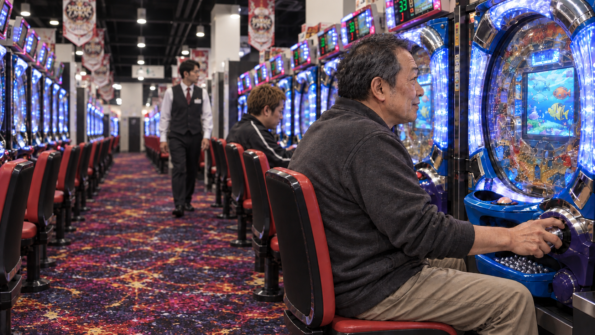

# ローグライク好きの私ですが、AIと一緒にドパガキに刺さるパチンコを作ってもいいですか？

<!-- ローグライク好き／AIと一緒にパチンコを作る -->

---

# ゲームが趣味

[これまで遊んだゲームを見る](https://playtime-panorama.superserio.us/76561199132069185)

<!-- Steam履歴／ゲーム紹介は軽く -->

---

<!-- _class: game-genres -->

# よく遊んでいるゲームのジャンル

FPS・TPS

サバイバル クラフト

シミュレー ション

工場・ 自動化

ローグライク ローグライト

アクション RPG

その他

<!-- FPSが多い／今回はローグライク -->

---

<!-- _class: invert shout -->
<!-- _paginate: false -->

# パチンコがやりたい！

<!-- スマホのメダルゲーム／手軽に遊びたい／だから作る -->

---

<!-- _class: equation -->
<!-- _paginate: false -->

# ローグライク × パチンコ ＝ ドパガキ

<!-- 好きな2つを掛け合わせる -->

---

<!-- _class: roguelike -->

# よく遊ぶのはローグライク

強化を選んで生き残り、次の挑戦へ。

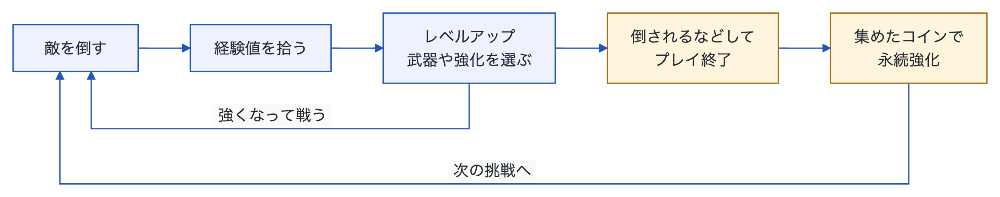

<!-- 敵 → 経験値 → 強化／終了 → 永続強化 → 再挑戦 -->

---

<!-- _class: pachinko-intro -->

# パチンコって、どう遊ぶ？

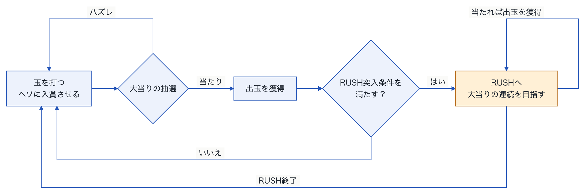

<!-- ヘソ → 抽選 → 大当り → RUSH -->

---

<!-- _class: original-machine -->

# 初めはオリジナルの台を作ろうとしたけど、

脳汁はでない。

<!-- 動くだけでは、気持ちよくない -->

---

<!-- _class: machine-spec -->

# e 東京喰種（通常版）

<figure class="machine-photo">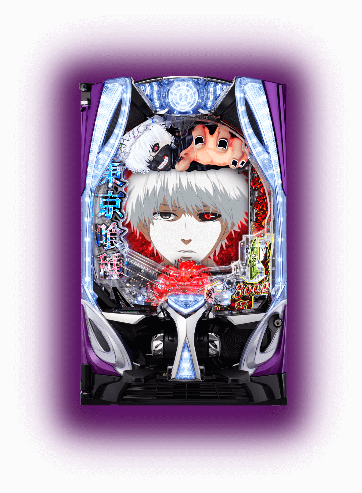</figure>

<table>
<tbody>
<tr><th>通常時の図柄揃い</th><td>約 1 / 399.9</td></tr>
<tr><th>大当り確率（チャージ込み）</th><td>約 1 / 199.9</td></tr>
<tr><th>RUSH突入率</th><td>約 51% <small>（チャージ含む）</small></td></tr>
<tr><th>RUSH継続率</th><td>約 75% <small>（ST130回）</small></td></tr>
<tr><th>初当り出玉（図柄揃い）</th><td>1,500個</td></tr>
<tr><th>RUSH中の出玉</th><td>3,000個以上</td></tr>
</tbody>
</table>

<!-- 参考にした通常版／見た目・スペック -->

---

<!-- _class: video-slide -->

# 東京喰種の演出

<video controls playsinline preload="metadata" poster="assets/tokyoghoul-modes.webp" aria-label="公式 パチンコ東京喰種 モード紹介まとめ動画"><source src="assets/tokyoghoul-modes.mp4" type="video/mp4"/>動画を再生できない場合は、同梱のMP4を開いてください。</video>

<!-- 映像・光・役物・音を見る -->

---

<!-- _class: unknown-terms -->

# 用語がわかんない。

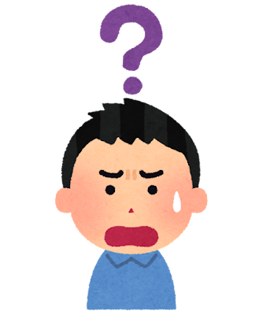
RUSH？
ヘソ？
入賞？
ST？
特図？
図柄揃い？

<!-- 自分も用語を知らなかった -->

---

<!-- _class: youtube-learning -->

# まずはYouTubeで勉強する。

実機の動画を見ながら、用語と遊びの流れを覚える。

<a href="https://www.youtube.com/watch?v=rimXVYU_qdg" target="_blank" rel="noopener noreferrer">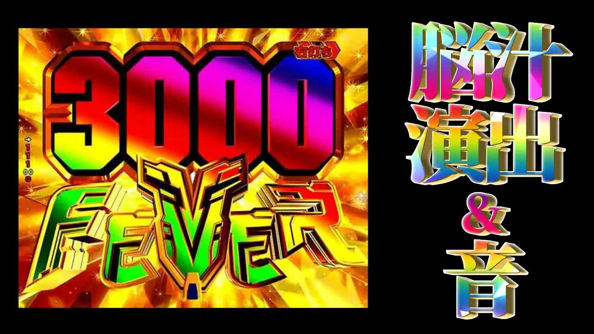</a>
<a href="https://www.youtube.com/watch?v=NakloAPrNTI&amp;t=291s" target="_blank" rel="noopener noreferrer">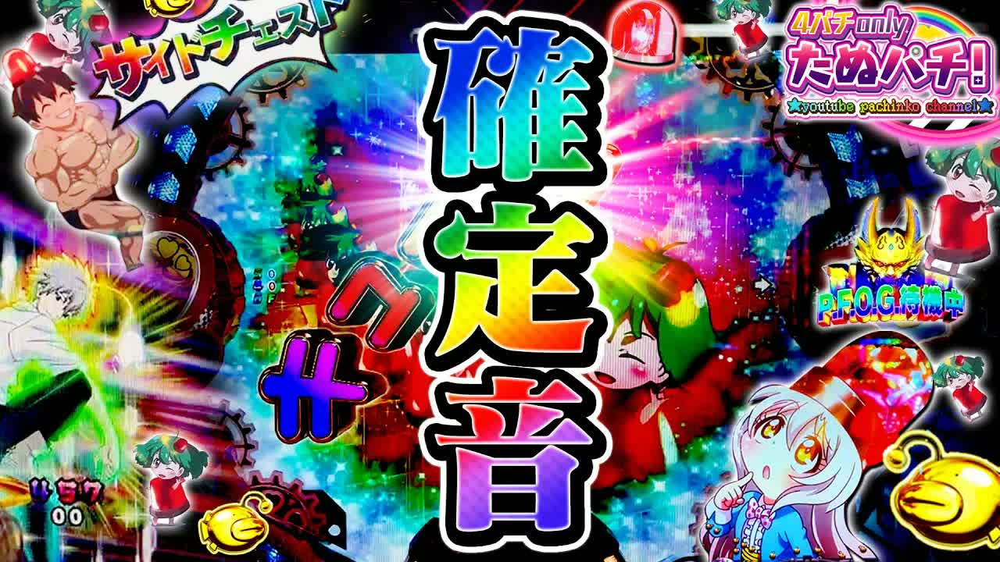</a>
<a href="https://www.youtube.com/watch?v=lhdA-1R2t1Y" target="_blank" rel="noopener noreferrer">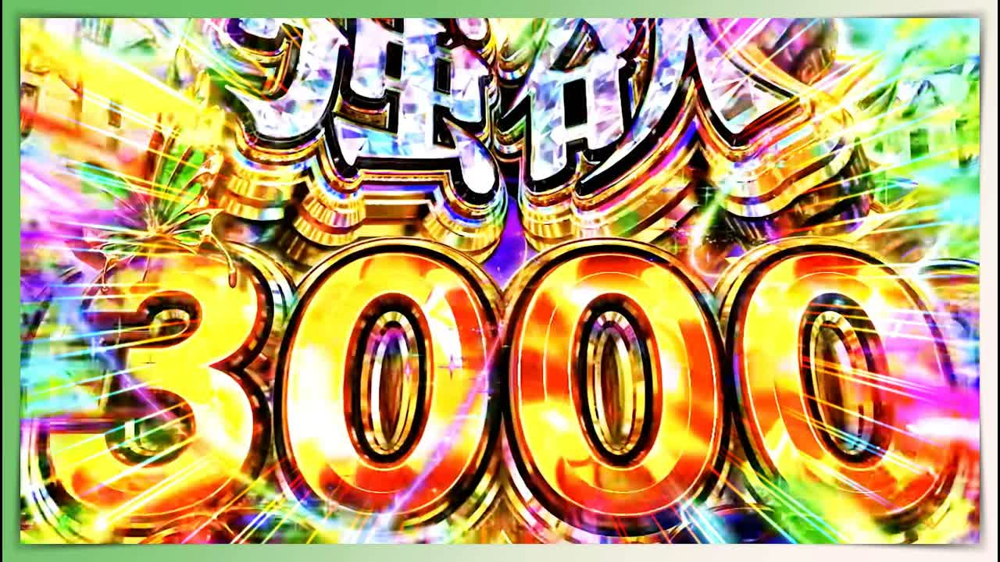</a>
<a href="https://www.youtube.com/watch?v=T0-EQM9ElL0&amp;t=30s" target="_blank" rel="noopener noreferrer">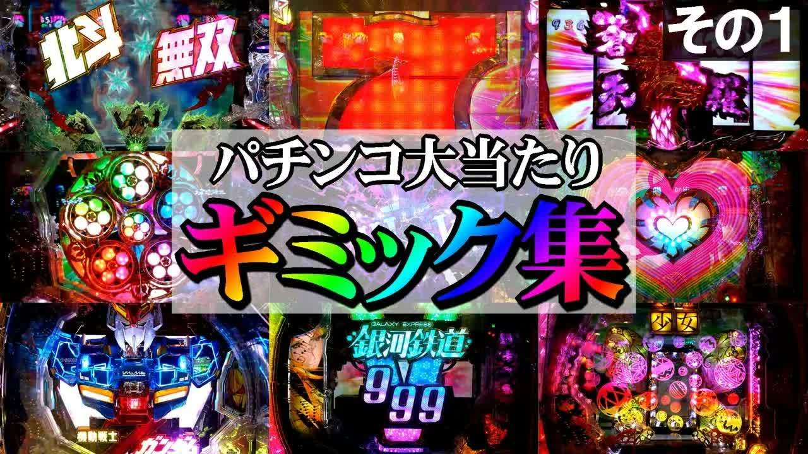</a>
<a href="https://www.youtube.com/watch?v=IRvp0ammDbg&amp;t=22s" target="_blank" rel="noopener noreferrer">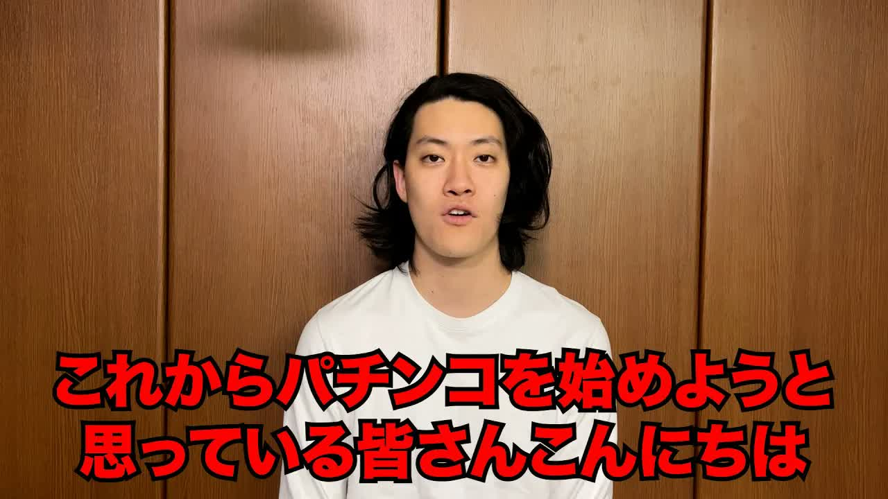</a>
<a href="https://www.youtube.com/watch?v=dCnV9syTbY4&amp;t=532s" target="_blank" rel="noopener noreferrer">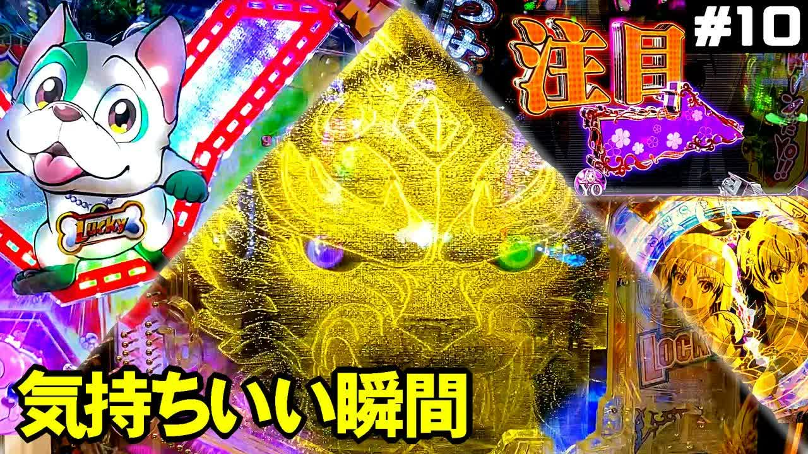</a>
<a href="https://www.youtube.com/watch?v=oE3A1TSjEEA&amp;t=253s" target="_blank" rel="noopener noreferrer">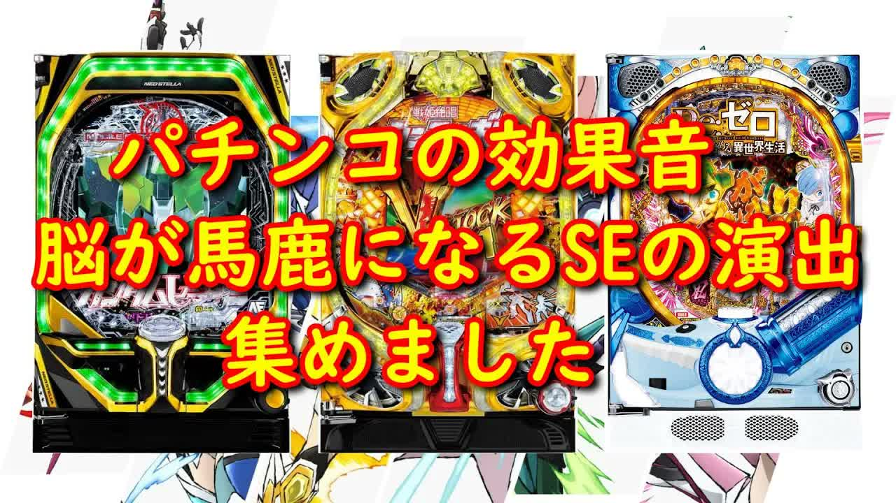</a>

<!-- 実機動画で学ぶ／AI任せにしない -->

---

<!-- _class: learning-pick -->

# 特にわかりやすかったのが、粗品の解説。

文字起こしして、内容を整理。 <strong>話の流れをフロー図にした。</strong>

<a class="learning-pick-diagram" href="assets/soshina-overview.png" target="_blank" rel="noopener noreferrer">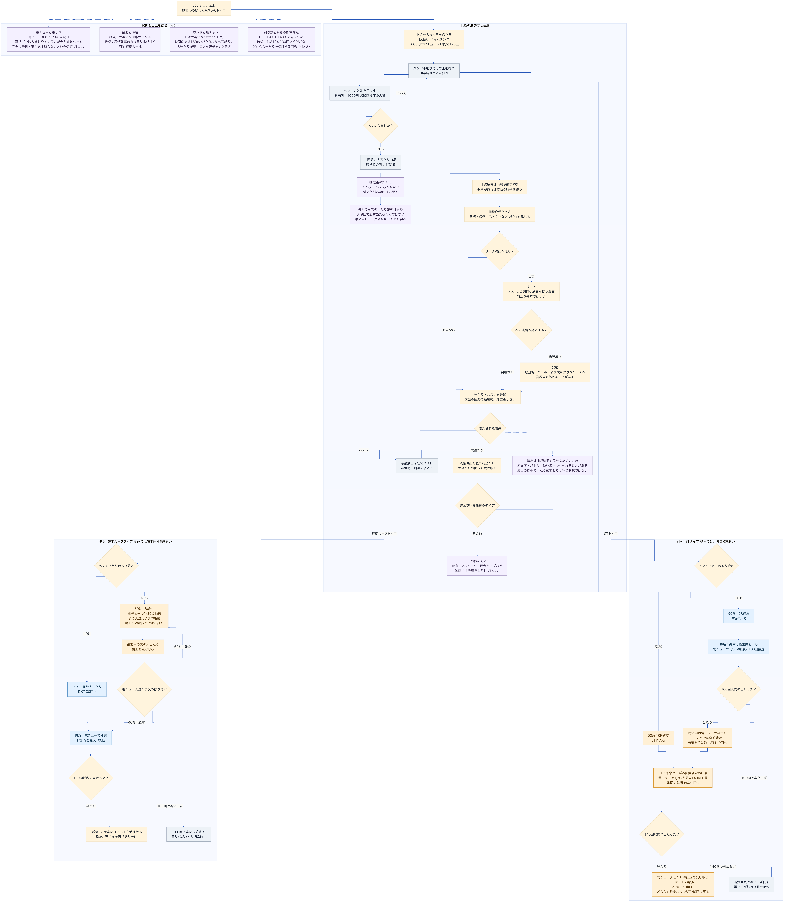</a>

<!-- 文字起こし → フロー図／基礎知識はわかったけど… -->

---

<!-- _class: breakdown -->

# でも、ドパガキは作れなかった。

<!-- 仕組みだけでは、ドキドキは作れない -->

---

<!-- _class: effects-mix -->

#  ＝ 映像 × 発光 × ギミック × 効果音

<!-- 映像 × 発光 × ギミック × 効果音／刺激の重なり -->

---

<!-- _class: effects-learning -->

# 脳汁の作り方は、まだ勉強中。

<!-- どう効くかは勉強中／ロゴ・文字から -->

---

<!-- _class: roguelike-transition -->

# ローグライクは？

<!-- ローグライクをどう組み込む？ -->

---

<!-- _class: silverball-flow -->

# パチンコに、成長と選択を。

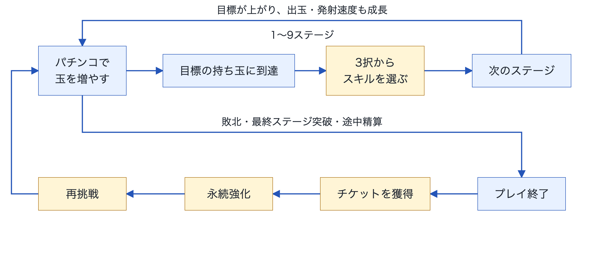

<!-- 目標 → 3択 → 次へ／終了 → チケット → 永続強化 -->

---

<!-- _class: demo-transition -->

# デモ

<!-- ゲームへ切替／見せたらスライドへ戻る -->

---

<!-- _class: future-features -->

# 今後の機能追加・改善予定

- スキル
- 台選択UI
- 台としての完成度
- 共通の仕組みを土台に、他の台へ展開

<!-- スキル・UI・完成度／まず1台／他の台へ -->
